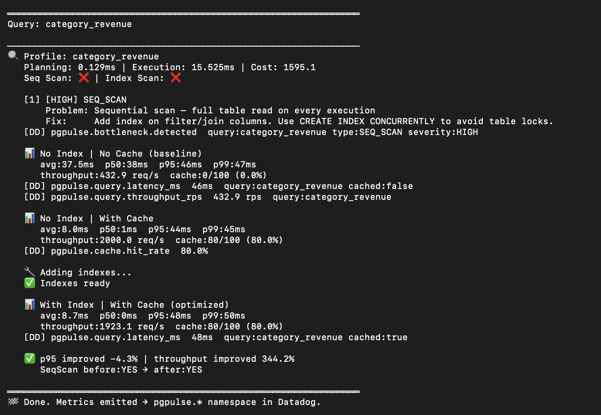

# PGPulse

**Postgres query profiler + Redis cache layer with automated bottleneck detection, plus a highly available, fault-tolerant job queue for payment-style settlement work.**

Benchmarks real query performance across three states (no index/no cache, no index/with cache, with index/with cache) using `EXPLAIN ANALYZE` to auto-detect sequential scans, missing indexes, and high-cost plans. Emits metrics to Datadog and runs on every push via CircleCI.

Built to simulate the class of scaling problems a backend performance team tackles daily: Postgres query bottlenecks under concurrent load, Redis caching layer design, and production-grade observability.

---

## What It Does

- Runs `EXPLAIN ANALYZE` on each query and automatically detects sequential scans, missing indexes, and high planner cost estimates
- Benchmarks three states per query at 20 concurrent workers across 100 iterations:
  - No Index / No Cache (baseline)
  - No Index / With Cache
  - With Index / With Cache (optimized)
- Reports p50 / p95 / p99 latency and throughput across all three states
- Emits metrics to Datadog under the `pgpulse.*` namespace (latency, throughput, cache hit rate, bottleneck events)
- CI pipeline via CircleCI runs the full benchmark suite on every push
- **Job queue (new):** settles orders through a BullMQ queue on Redis with multiple worker processes, idempotent Postgres ledger writes, retries, worker-crash recovery, Redis Sentinel failover and Patroni Postgres failover (see [Fault-Tolerant Job Queue](#fault-tolerant-job-queue))

---

## Stack

Node.js · TypeScript · PostgreSQL 15/16 · Patroni · etcd · Redis 7 · BullMQ · Redis Sentinel · Datadog (hot-shots / DogStatsD) · Docker · CircleCI

---

## Project Structure

```
pgpulse/
├── .circleci/
│   └── config.yml              # CI pipeline — seeds DB and runs benchmark on push
├── src/
│   ├── db/
│   │   ├── postgres.ts         # pg connection pool
│   │   ├── primaryPool.ts      # pool that follows the Postgres primary through a Patroni failover
│   │   └── seed.ts             # 10k users, 1k products, 50k orders (no indexes)
│   ├── cache/
│   │   └── redis.ts            # cache-aside pattern with TTL
│   ├── profiler/
│   │   ├── queryProfiler.ts    # EXPLAIN ANALYZE runner and plan parser
│   │   └── bottleneckDetector.ts  # seq scan, high cost, missing index detection
│   ├── benchmark/
│   │   └── runner.ts           # concurrent load runner, 4-phase comparison
│   ├── metrics/
│   │   └── datadog.ts          # DogStatsD client, pgpulse.* namespace
│   ├── queue/
│   │   ├── connection.ts       # single Redis or Sentinel connection (picked by env)
│   │   ├── settlement.ts       # schema + one-transaction idempotent settlement
│   │   ├── worker.ts           # one BullMQ worker process
│   │   ├── bench.ts            # baseline / kill / failover scenarios + correctness checks
│   │   └── chaos.ts            # steady traffic + Redis and Postgres primary crashes -> availability %
│   └── index.ts
├── ha/
│   ├── patroni.yml             # Patroni config (synchronous replication, 20s leader lease)
│   └── Dockerfile.patroni      # postgres:16 + Patroni
├── scripts/
│   ├── ha-local.sh             # Redis primary + replica + 3 Sentinels without Docker
│   └── pg-ha-local.sh          # etcd + 2 Patroni nodes without Docker
├── Dockerfile                  # image for the in-network benches
├── docker-compose.yml          # default stack + "ha" profile (Redis HA, Postgres HA, 3-node etcd)
├── package.json
└── tsconfig.json
```

---

## Setup and Run

**Prerequisites:** Docker, Node.js 18+

```bash
# 1. Clone and install
git clone https://github.com/your-username/pgpulse
cd pgpulse
npm install

# 2. Start Postgres + Redis
docker-compose up -d

# 3. Seed the database (~2-3 min — inserts 110k+ rows without indexes)
npm run seed

# 4. Run the full benchmark
npm run dev
```

Datadog agent is optional locally. If not running, metrics still print to console with the `[DD]` prefix so you can observe the full namespace output.

---

## Benchmark Results

Tested on 50,000 orders, 10,000 users, 1,000 products. Concurrency: 20 workers. Iterations: 100 per query.

### orders_by_status
JOIN across orders + users, filtered by status, ordered by created_at.

| State                    | avg    | p50   | p95   | p99   | Throughput    | Cache Hit |
|--------------------------|--------|-------|-------|-------|---------------|-----------|
| No Index / No Cache      | 25.7ms | 22ms  | 42ms  | 50ms  | 617.3 req/s   | 0%        |
| No Index / With Cache    | 3.8ms  | 1ms   | 19ms  | 21ms  | 4,166.7 req/s | 80%       |
| With Index / With Cache  | 0.6ms  | 0ms   | 2ms   | 2ms   | 25,000 req/s  | 80%       |

**p95 improved 95.2% | Throughput improved 3,950% | SeqScan eliminated**

---

### user_order_history
Filter orders by user_id with date ordering.

| State                    | avg   | p50  | p95  | p99  | Throughput     | Cache Hit |
|--------------------------|-------|------|------|------|----------------|-----------|
| No Index / No Cache      | 5.3ms | 5ms  | 8ms  | 9ms  | 2,777.8 req/s  | 0%        |
| No Index / With Cache    | 1.4ms | 1ms  | 6ms  | 6ms  | 10,000 req/s   | 80%       |
| With Index / With Cache  | 1.7ms | 1ms  | 5ms  | 6ms  | 6,666.7 req/s  | 80%       |

**p95 improved 37.5% | Throughput improved 140% | SeqScan eliminated**

---

### category_revenue
Full-table GROUP BY aggregate across order_items + products.

| State                    | avg    | p50   | p95   | p99   | Throughput    | Cache Hit |
|--------------------------|--------|-------|-------|-------|---------------|-----------|
| No Index / No Cache      | 37.5ms | 38ms  | 46ms  | 47ms  | 432.9 req/s   | 0%        |
| No Index / With Cache    | 8.0ms  | 1ms   | 44ms  | 45ms  | 2,000.0 req/s | 80%       |
| With Index / With Cache  | 8.7ms  | 0ms   | 48ms  | 50ms  | 1,923.1 req/s | 80%       |

**Throughput improved 344% via cache | SeqScan persists (see note below)**

> **Why indexes didn't help here:** The profiler correctly identified that this full-table `GROUP BY` aggregate requires scanning all rows regardless of indexing; the query planner chose a sequential scan because it genuinely is faster for this access pattern. The right optimization here is a **materialized view with scheduled refresh**, not an index. PGPulse surfaced this automatically via `EXPLAIN ANALYZE` output rather than blindly recommending indexes.

---

## Benchmark Output




---

## Datadog Metrics (pgpulse.* namespace)

| Metric                        | Type      | Tags                              |
|-------------------------------|-----------|-----------------------------------|
| `pgpulse.query.latency_ms`    | Histogram | `query:<name>`, `cached:<bool>`   |
| `pgpulse.query.throughput_rps`| Gauge     | `query:<name>`                    |
| `pgpulse.cache.hit_rate`      | Gauge     | —                                 |
| `pgpulse.bottleneck.detected` | Counter   | `query:<name>`, `type:<type>`, `severity:<level>` |

Bottleneck types: `SEQ_SCAN`, `HIGH_COST`, `SLOW_EXECUTION`, `MISSING_INDEX`

---

## CI Pipeline

CircleCI runs the full benchmark on every push using Docker service containers for Postgres and Redis. No external dependencies required.

A second job, `queue-resilience`, runs the kill test (5,000 jobs, SIGKILL 2 of 4 workers, 2% injected failures) and fails the build if any job is lost, settled twice, or the ledger doesn't reconcile.

```yaml
# .circleci/config.yml (excerpt)
jobs:
  benchmark:
    docker:
      - image: cimg/node:20.0
      - image: cimg/postgres:15.0
      - image: cimg/redis:7.0
    steps:
      - checkout
      - run: npm ci
      - run: npm run build
      - run: npm run seed
      - run: npm start
```

---

## Fault-Tolerant Job Queue

The profiler side of PGPulse only reads from Postgres. I wanted to see what happens on the write side when things break, so I added a job queue that settles orders the way a payments backend would: every order becomes a job, and a pool of worker processes pulls jobs from Redis and writes a ledger entry in Postgres.

The question I was trying to answer: **if a worker crashes mid-job, the Redis primary dies, or the Postgres primary dies, do we lose any settlements, or settle anything twice? And how long are we down?**

### How it works

```
 bench ──addBulk(jobId = idempotency key)──► BullMQ queue (Redis / Sentinel)
                                                   │
                     ┌──────────────┬──────────────┼──────────────┐
                     ▼              ▼              ▼              ▼
                 worker w1      worker w2      worker w3      worker w4     (separate OS processes)
                     │  one Postgres transaction per job:
                     │  attempts++ → INSERT ledger ... ON CONFLICT DO NOTHING → mark order settled
                     ▼
     PostgreSQL primary ──sync replication──► standby      (Patroni + 3-node etcd promotes the standby)
     (settle_orders, ledger_entries)  ◄── source of truth for every check
```

- **Distributed workers.** Each worker is its own Node process with its own Redis and Postgres connections, so killing one doesn't take the others down. BullMQ hands each job to exactly one worker at a time using a lock in Redis.
- **Idempotency key.** The job id (`settle-<orderId>`) is also the ledger's primary key. If a job runs twice (a worker committed but died before acking, or a retry after a failover), the second run hits `ON CONFLICT DO NOTHING` and changes nothing.
- **One transaction per settlement.** The ledger row and the order status change commit together or not at all. If anything throws before `COMMIT`, Postgres rolls it back and BullMQ retries with exponential backoff.
- **Crash recovery.** Workers renew a 5s lock on each job they're working on. When a worker is SIGKILLed, its locks stop being renewed, and a surviving worker's stalled-job checker puts those jobs back on the queue.
- **Redis high availability.** In the `ha` profile, Redis runs as a primary + replica watched by 3 Sentinels (quorum 2). When the primary dies, Sentinel promotes the replica and the workers' ioredis clients ask Sentinel for the new primary and reconnect.
- **Postgres high availability.** Postgres runs as a primary + synchronous standby managed by Patroni, with leader election in a 3-node etcd cluster. Synchronous replication means `COMMIT` only returns once the standby has the write, so promoting the standby can't lose a settlement that was already committed. When the primary dies, Patroni promotes the standby once the 20s leader lease expires.
- **Primary-aware connection pool.** Instead of HAProxy, `primaryPool.ts` asks each node `SELECT pg_is_in_recovery()` and connects to the one that says it's the primary. On a connection error, a read-only error, or a timeout, it drops the pool and looks again. Every query has an 8s deadline, so a `COMMIT` stuck waiting on a standby that just died fails and retries instead of hanging forever.
- **Capped retries.** Retries back off 100ms, 200ms, 400ms... capped at 1s. With plain exponential backoff, jobs sat idle 6–12s *after* a failover had already finished.
- **Outbox sweep.** Redis replication is asynchronous, so a job written to the Redis primary right before it crashes can vanish. Postgres is the source of truth: every 2s, any order still `pending` 15s after it should have arrived, with no job in Redis, gets re-queued. The idempotency key makes this safe even if the job wasn't really gone.

### What the bench checks

`bench.ts` doesn't trust the queue's own counters. After every run it checks Postgres directly:

| Check | How |
|---|---|
| Lost jobs | orders still `pending` at the end |
| Double settlements | orders with more than one ledger row |
| Ledger reconciliation | sum of settled order amounts = sum of ledger amounts |
| Redeliveries absorbed | committed attempts minus ledger rows (jobs that ran again and were safely ignored) |
| Recovery time | longest gap with zero settlements after each fault (from `settled_at` timestamps) |
| Availability (chaos) | share of 1-second windows in the traffic window that had at least one settlement |

The bench exits non-zero if anything is lost, doubled, or doesn't reconcile, so CI can gate on it.

### Run it

```bash
npm install && npm run build

# single Redis (docker compose up -d)
npm run queue:baseline                                          # throughput, no faults
KILL_WORKERS=2 FAIL_RATE=0.02 npm run queue:kill                # SIGKILL 2 of 4 workers at 40%, plus 2% injected failures

# Redis HA failover, fully inside Docker (recommended on macOS)
docker compose --profile ha up --build ha-bench
docker compose --profile ha down                                # reset the cluster before running it again

# or without Docker (brew install redis)
npm run ha:up
REDIS_SENTINELS=127.0.0.1:26390,127.0.0.1:26391,127.0.0.1:26392 npm run queue:failover
npm run ha:down

# chaos: 200 jobs/s for 5 min, crash the Redis primary at 33% and the Postgres primary at 66%
docker compose --profile ha up --build ha-bench
docker compose --profile ha down                                # reset before the next run
DURATION_S=600 FAULTS=postgres@0.5 docker compose --profile ha up --build ha-bench   # other mixes

# chaos without Docker (brew install redis etcd postgresql@16 && pip3 install "patroni[etcd3]" psycopg2-binary)
npm run ha:up && npm run pg-ha:up
PG_HOSTS=127.0.0.1:5433,127.0.0.1:5434 PG_DATABASE=postgres \
REDIS_SENTINELS=127.0.0.1:26390,127.0.0.1:26391,127.0.0.1:26392 npm run queue:chaos
npm run pg-ha:down && npm run ha:down
```

How the chaos test crashes Postgres: it runs `COPY ... TO PROGRAM` as superuser on the current primary to `SIGKILL` that node's Patroni agent and its postmaster together. Killing only Postgres isn't a failover test, because Patroni would just restart it in place. Killing both leaves the node dead, so etcd's leader lease has to expire and the standby has to take over.

Chaos knobs: `RATE` (200 jobs/s), `DURATION_S` (300), `FAULTS` (`redis@0.33,postgres@0.66`, or `none` for a control run), `REDRIVE_AFTER_S` (15).

Knobs: `JOBS` (10000), `WORKERS` (4), `WORKER_CONCURRENCY` (10), `WORK_MS` simulated provider call (10), `FAIL_RATE` (0), `KILL_WORKERS` (2), `TRIGGER_AT` (0.4). Every run writes a JSON summary to `results/`.

### My results

Measured on my MacBook Air M3. Numbers come from `results/queue-*.json`.

| Scenario | Jobs | Throughput | Lost | Double-settled | Recovery |
|---|---|---|---|---|---|
| Baseline, 4 workers | 10,000 | _TBD_ jobs/s | _TBD_ | _TBD_ | n/a |
| SIGKILL 2 of 4 workers + 2% injected failures | 10,000 | _TBD_ jobs/s | _TBD_ | _TBD_ | _TBD_ stalled jobs re-run, longest stall _TBD_ ms |
| Redis primary crash (Sentinel failover) | 10,000 | _TBD_ jobs/s | _TBD_ | _TBD_ | promotion _TBD_ ms, longest stall _TBD_ ms |
| Chaos: 200 jobs/s for 5 min, Redis + Postgres primary crashes | 60,000 | 200 jobs/s offered | _TBD_ | _TBD_ | Redis stall _TBD_ s, Postgres stall _TBD_ s, availability _TBD_ % |

How to read the availability number: it depends on how often things crash. Two primary crashes in 5 minutes is far more failure than a real system sees, so the percentage is low on purpose. The per-crash stall times are the numbers that carry over to a real deployment.

### What I learned / limits

- Redis replication is asynchronous, so a write acked by the primary can be lost if it dies before the replica copies it. I call `WAIT 1` after enqueueing so the jobs themselves are on the replica before the crash. Completed-state writes can still be lost in a failover, and those jobs just run again, which is exactly why the idempotency key matters.
- This is "at-least-once delivery + idempotent writes", not exactly-once delivery. The ledger primary key is what turns it into exactly-once *effects*.
- Recovery time after a worker crash is bounded by the lock duration (5s here). A shorter lock recovers faster but risks a slow job getting picked up twice, and the idempotency key handles that case too.
- **Failover is never zero downtime.** A Redis crash stalls settlements for a few seconds (Sentinel's 2s down-after plus election), and a Postgres crash for up to ~20s (Patroni's minimum leader lease). The guarantee is *no lost or double-settled payments*, not *no pause*.
- **Synchronous replication costs latency.** Every `COMMIT` waits for the standby. If the standby dies, Patroni (non-strict sync mode) lets the primary keep committing alone, which trades durability for availability until the standby is back. `synchronous_mode_strict` would flip that trade.
- **What's still a single point of failure:** the bench/producer process itself, and everything running on one laptop. etcd has 3 nodes and both data stores have a standby, but they all share one machine and one Docker network.
- I first tried killing "the postmaster's parent process" to take out Patroni. On my machine that parent wasn't Patroni at all, so the kill command now finds the Patroni process by its config file and never touches PID 1.

---

## Bottleneck Detection Logic

The profiler parses raw `EXPLAIN ANALYZE` output and flags:

- **SEQ_SCAN** — full table read detected; suggests `CREATE INDEX CONCURRENTLY` on filter columns
- **SLOW_EXECUTION** — execution time exceeds 100ms threshold; suggests indexing or Redis caching
- **HIGH_COST** — planner cost estimate exceeds 10,000; suggests reviewing JOINs and considering materialized views
- **MISSING_INDEX** — no index scan on >1,000 estimated rows; suggests composite index on WHERE clause columns

Severity is set to `HIGH` when cost exceeds 1,000 or execution exceeds 500ms, `MEDIUM` otherwise.
