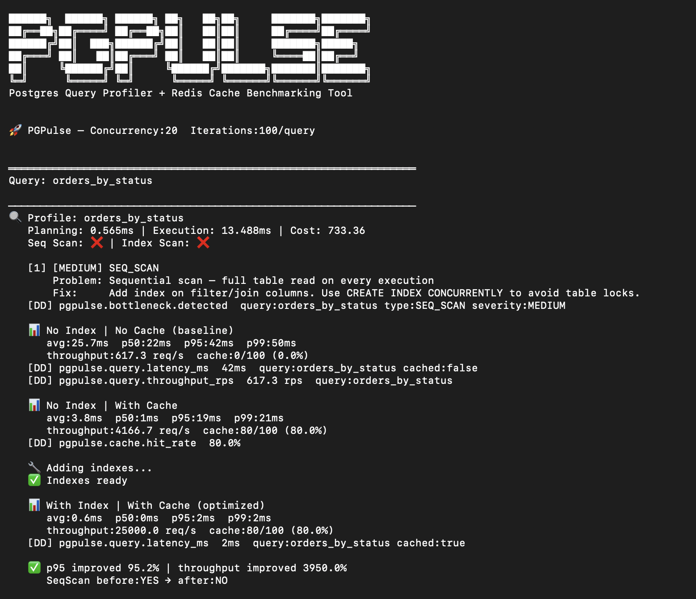
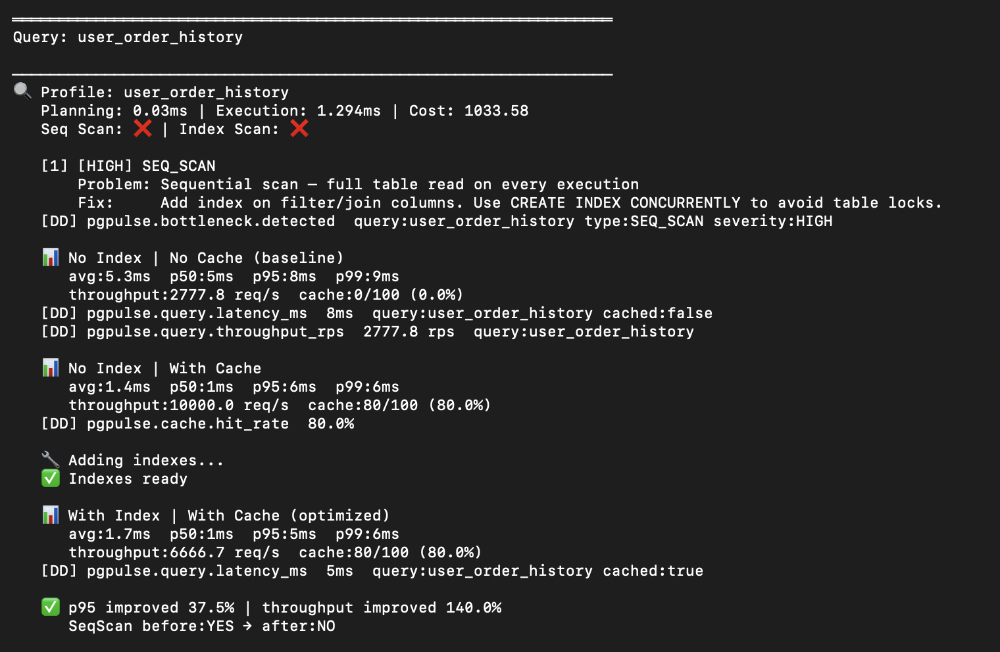

# PGPulse

**Postgres query profiler + Redis cache layer with automated bottleneck detection.**

Benchmarks real query performance across three states — no index/no cache, no index/with cache, and with index/with cache — using `EXPLAIN ANALYZE` to auto-detect sequential scans, missing indexes, and high-cost plans. Emits metrics to Datadog and runs on every push via CircleCI.

Built to simulate the class of scaling problems a backend performance team tackles daily: Postgres query bottlenecks under concurrent load, Redis caching layer design, and production-grade observability.

---

## What It Does

- Runs `EXPLAIN ANALYZE` on each query and automatically detects sequential scans, missing indexes, and high planner cost estimates
- Benchmarks three states per query at 20 concurrent workers across 100 iterations:
  - No Index / No Cache (baseline)
  - No Index / With Cache
  - With Index / With Cache (optimized)
- Reports p50 / p95 / p99 latency and throughput across all three states
- Emits metrics to Datadog under the `pgpulse.*` namespace (latency, throughput, cache hit rate, bottleneck events)
- CI pipeline via CircleCI runs the full benchmark suite on every push

---

## Stack

Node.js · TypeScript · PostgreSQL 15 · Redis 7 · Datadog (hot-shots / DogStatsD) · Docker · CircleCI

---

## Project Structure

```
pgpulse/
├── .circleci/
│   └── config.yml              # CI pipeline — seeds DB and runs benchmark on push
├── src/
│   ├── db/
│   │   ├── postgres.ts         # pg connection pool
│   │   └── seed.ts             # 10k users, 1k products, 50k orders (no indexes)
│   ├── cache/
│   │   └── redis.ts            # cache-aside pattern with TTL
│   ├── profiler/
│   │   ├── queryProfiler.ts    # EXPLAIN ANALYZE runner and plan parser
│   │   └── bottleneckDetector.ts  # seq scan, high cost, missing index detection
│   ├── benchmark/
│   │   └── runner.ts           # concurrent load runner, 4-phase comparison
│   ├── metrics/
│   │   └── datadog.ts          # DogStatsD client, pgpulse.* namespace
│   └── index.ts
├── docker-compose.yml
├── package.json
└── tsconfig.json
```

---

## Setup and Run

**Prerequisites:** Docker, Node.js 18+

```bash
# 1. Clone and install
git clone https://github.com/your-username/pgpulse
cd pgpulse
npm install

# 2. Start Postgres + Redis
docker-compose up -d

# 3. Seed the database (~2-3 min — inserts 110k+ rows without indexes)
npm run seed

# 4. Run the full benchmark
npm run dev
```

Datadog agent is optional locally. If not running, metrics still print to console with the `[DD]` prefix so you can observe the full namespace output.

---

## Benchmark Results

Tested on 50,000 orders, 10,000 users, 1,000 products. Concurrency: 20 workers. Iterations: 100 per query.

### orders_by_status
JOIN across orders + users, filtered by status, ordered by created_at.

| State                    | avg    | p50   | p95   | p99   | Throughput    | Cache Hit |
|--------------------------|--------|-------|-------|-------|---------------|-----------|
| No Index / No Cache      | 25.7ms | 22ms  | 42ms  | 50ms  | 617.3 req/s   | 0%        |
| No Index / With Cache    | 3.8ms  | 1ms   | 19ms  | 21ms  | 4,166.7 req/s | 80%       |
| With Index / With Cache  | 0.6ms  | 0ms   | 2ms   | 2ms   | 25,000 req/s  | 80%       |

**p95 improved 95.2% | Throughput improved 3,950% | SeqScan eliminated**

---

### user_order_history
Filter orders by user_id with date ordering.

| State                    | avg   | p50  | p95  | p99  | Throughput     | Cache Hit |
|--------------------------|-------|------|------|------|----------------|-----------|
| No Index / No Cache      | 5.3ms | 5ms  | 8ms  | 9ms  | 2,777.8 req/s  | 0%        |
| No Index / With Cache    | 1.4ms | 1ms  | 6ms  | 6ms  | 10,000 req/s   | 80%       |
| With Index / With Cache  | 1.7ms | 1ms  | 5ms  | 6ms  | 6,666.7 req/s  | 80%       |

**p95 improved 37.5% | Throughput improved 140% | SeqScan eliminated**

---

### category_revenue
Full-table GROUP BY aggregate across order_items + products.

| State                    | avg    | p50   | p95   | p99   | Throughput    | Cache Hit |
|--------------------------|--------|-------|-------|-------|---------------|-----------|
| No Index / No Cache      | 37.5ms | 38ms  | 46ms  | 47ms  | 432.9 req/s   | 0%        |
| No Index / With Cache    | 8.0ms  | 1ms   | 44ms  | 45ms  | 2,000.0 req/s | 80%       |
| With Index / With Cache  | 8.7ms  | 0ms   | 48ms  | 50ms  | 1,923.1 req/s | 80%       |

**Throughput improved 344% via cache | SeqScan persists — see note below**

> **Why indexes didn't help here:** The profiler correctly identified that this full-table `GROUP BY` aggregate requires scanning all rows regardless of indexing — the query planner chose a sequential scan because it genuinely is faster for this access pattern. The right optimization here is a **materialized view with scheduled refresh**, not an index. PGPulse surfaced this automatically via `EXPLAIN ANALYZE` output rather than blindly recommending indexes.

---

## Benchmark Output






---

## Datadog Metrics (pgpulse.* namespace)

| Metric                        | Type      | Tags                              |
|-------------------------------|-----------|-----------------------------------|
| `pgpulse.query.latency_ms`    | Histogram | `query:<name>`, `cached:<bool>`   |
| `pgpulse.query.throughput_rps`| Gauge     | `query:<name>`                    |
| `pgpulse.cache.hit_rate`      | Gauge     | —                                 |
| `pgpulse.bottleneck.detected` | Counter   | `query:<name>`, `type:<type>`, `severity:<level>` |

Bottleneck types: `SEQ_SCAN`, `HIGH_COST`, `SLOW_EXECUTION`, `MISSING_INDEX`

---

## CI Pipeline

CircleCI runs the full benchmark on every push using Docker service containers for Postgres and Redis. No external dependencies required.

```yaml
# .circleci/config.yml (excerpt)
jobs:
  benchmark:
    docker:
      - image: cimg/node:20.0
      - image: cimg/postgres:15.0
      - image: cimg/redis:7.0
    steps:
      - checkout
      - run: npm ci
      - run: npm run build
      - run: npm run seed
      - run: npm start
```

---

## Bottleneck Detection Logic

The profiler parses raw `EXPLAIN ANALYZE` output and flags:

- **SEQ_SCAN** — full table read detected; suggests `CREATE INDEX CONCURRENTLY` on filter columns
- **SLOW_EXECUTION** — execution time exceeds 100ms threshold; suggests indexing or Redis caching
- **HIGH_COST** — planner cost estimate exceeds 10,000; suggests reviewing JOINs and considering materialized views
- **MISSING_INDEX** — no index scan on >1,000 estimated rows; suggests composite index on WHERE clause columns

Severity is set to `HIGH` when cost exceeds 1,000 or execution exceeds 500ms, `MEDIUM` otherwise.